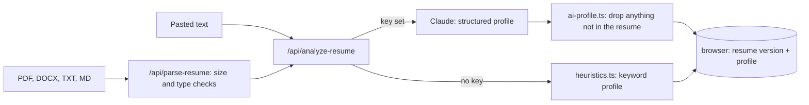
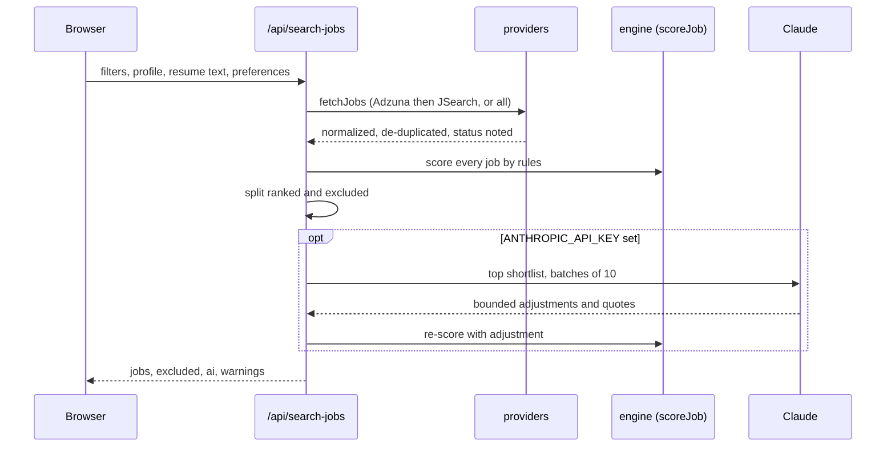

# Application and data flow

[Home](../README.md)

## Resume processing

## Job search

## Where data lives

| Data | Location | Leaves the browser when |
| --- | --- | --- |
| Resume text, profile versions | `localStorage` | Parsing, analysis, search, any AI button, sync |
| Preferences, eligibility facts | `localStorage` | Search, morning run (via sync), assessment |
| Search results | `localStorage` | Not sent back |
| Applications, interviews, notes | `localStorage` | Sync only |
| Contacts, watchlist, feedback | `localStorage` | Sync only |
| Uploaded files | Server memory during parsing | Not stored |
| Daily run results | Supabase `daily_runs` | Written by the server |

`localStorage` keys start with `cmh:` (`resumes`, `activeResume`, `preferences`, `filters`, `results`,
`applications`, `intel`, `contacts`, `watchlist`, `feedback`, `insights`, `assessments` **[PR 7]**, `refine`,
`sort`, `tab`, `appview`, `cloud`, `schema`, plus `backup:*` and `recovered:*`). Layout upgrades are in
[storage.ts](../../src/lib/storage.ts).

Privacy detail: [Security overview](../07-security/security-overview.md#sensitive-data).
