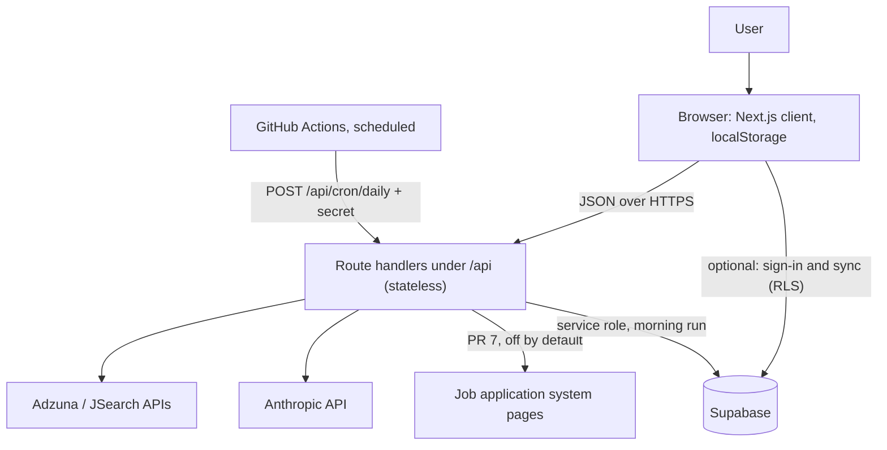
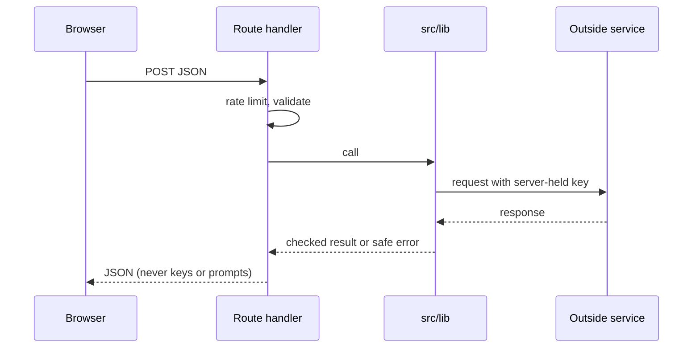

# System architecture (frontend and backend)

[Home](../README.md)

## Contents
[Diagram](#diagram) · [Folders](#folders) · [Frontend](#frontend) · [Backend](#backend) · [Request lifecycle](#request-lifecycle)

## Diagram

## Folders

| Path | Holds |
| --- | --- |
| [src/app](../../src/app) | One page (`page.tsx`), layout, error pages, and `api/*/route.ts` |
| [src/components](../../src/components) | UI; `contacts/` for the recruiter finder |
| [src/lib](../../src/lib) | All logic; mostly pure functions usable in tests |
| [src/types](../../src/types) | Shared types (`job.ts`, `contacts.ts`, `watchlist.ts`) |
| [tests](../../tests), [e2e](../../e2e) | Vitest and Playwright |
| [supabase/migrations](../../supabase/migrations) | SQL for the optional database |
| [scripts](../../scripts) | Evaluation and benchmark runners |

Library sub-folders: `matching/`, `providers/`, `cloud/`, `contacts/`, `watchlist/`, `candidate/`,
`eligibility/`, `search/`, `ai/`, `jobs/`; **[PR 7]** `net/`, `assessment/`, `analytics/`, `benchmark/`.

## Frontend

* **Single route.** The app is one client page, [page.tsx](../../src/app/page.tsx); sections are tabs chosen in
  [AppShell.tsx](../../src/components/AppShell.tsx), not separate URLs.
* **State.** React state in `page.tsx`, persisted with
  [use-persistent-state.ts](../../src/lib/use-persistent-state.ts). Stored values are validated on load; broken
  ones are set aside, not overwritten.
* **Context** for cross-cutting needs: job details (`DetailContext` in
  [JobDetailDialog.tsx](../../src/components/JobDetailDialog.tsx)), contacts
  ([contacts/context.tsx](../../src/components/contacts/context.tsx)), feedback
  ([feedback-context.tsx](../../src/components/feedback-context.tsx)).
* No state library or client router is used.
* Scoring code is shared: the browser can call the engine (for example after a posting check).

## Backend

* Next.js route handlers only; no separate server. All declare `maxDuration`.
* Each route: rate limit → validate with Zod or manual checks → call libraries → return JSON `{...}` or
  `{error}`. Logic lives in `src/lib`, not in routes.
* Modules that hold secrets import `server-only` so they cannot be bundled into the browser.
* Native packages are excluded from bundling in [next.config.ts](../../next.config.ts).
* In-memory state (rate limits, caches, provider health) is **per server instance** and lost on restart.

## Request lifecycle

Related: [Data flow](data-flow.md) · [Integrations](integrations.md) · [API reference](../04-technical-reference/api-reference.md)
