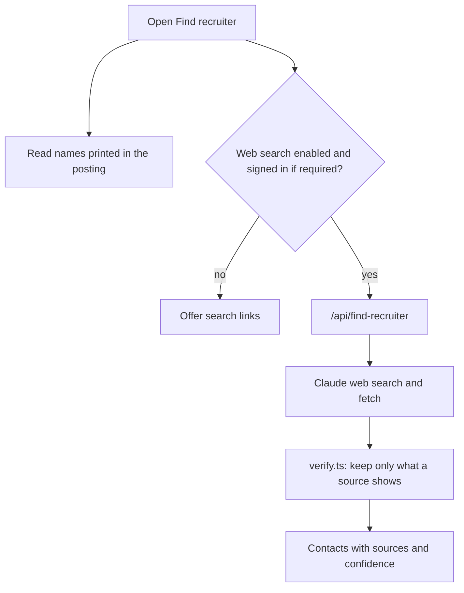

# HR and Recruiter Finder

[Home](../README.md) · [Features](feature-overview.md)

## Overview
Finds people publicly named for hiring on one job, keeps contacts, and drafts messages you send yourself.

## Sources of a contact
1. The posting's own text (free) — [extract.ts](../../src/lib/contacts/extract.ts).
2. Paid web search, only if enabled — [web-search.ts](../../src/lib/contacts/web-search.ts): up to 8 searches and
   5 page reads per lookup; LinkedIn and other login-only sites are blocked from being read.
3. People you add yourself.
4. Search links you open — [links.ts](../../src/lib/contacts/links.ts).

## Flow

## Verification rules
A person is kept only if a result title or quoted passage names them; titles, emails and phones only if a source
shows them next to the name. Confidence and status come from fixed rules, never above 98. Nothing is built from
a name pattern ([verify.ts](../../src/lib/contacts/verify.ts), [model.ts](../../src/lib/contacts/model.ts)).

## Messages and networking
LinkedIn note, introduction, follow-up and email drafts ([drafts.ts](../../src/lib/contacts/drafts.ts));
optional AI wording via `/api/networking-draft`, discarded if it claims anything unsupported. Nothing is sent
for you.

## UI
[components/contacts/](../../src/components/contacts).

## Configuration
`ANTHROPIC_API_KEY`, `RECRUITER_WEB_SEARCH`, `FIND_RECRUITER_MAX_PER_HOUR`.

## Errors and limits
Switched-off lookups return an explanation, not an error. Limits: 3 per minute and 12 per hour per client, plus
a per-instance hourly cap.

## Limitations
The web search path has only been tested against mocked responses; hit rate, latency and cost are unmeasured
(`npm run eval:recruiters` measures them with a key). Names on no public page cannot be found.
