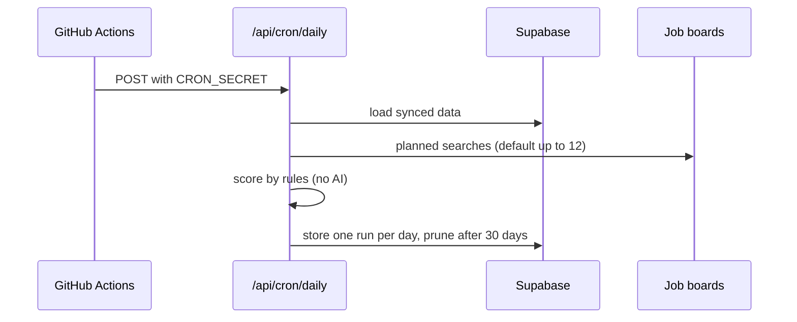

# Settings, backup, cloud sync and the morning run

[Home](../README.md) · [Features](feature-overview.md)

## Settings
[SettingsPanel.tsx](../../src/components/SettingsPanel.tsx): minimum salary, cities, primary and secondary
roles, match weights, eligibility facts (work status, clearance, languages, excluded words —
[EligibilityFields.tsx](../../src/components/EligibilityFields.tsx)), data export and import.
**[PR 7]**: transition and excluded roles, and "my qualification list is complete".

## Backup
[backup.ts](../../src/lib/backup.ts): JSON export of resumes, preferences, applications, history, contacts,
watchlist and feedback; import can merge or replace; maximum 20 MB. **It contains your resume text** — do not
share or commit it.

## Cloud sync (optional)
Sign in with an email and password you created in Supabase (no sign-up screen).
[AccountPanel.tsx](../../src/components/AccountPanel.tsx), [cloud/sync.ts](../../src/lib/cloud/sync.ts),
[use-cloud.ts](../../src/lib/cloud/use-cloud.ts).

* Every save names the version it started from; a conflict merges and keeps a local copy first.
* Deletions are not carried over by a merge.

## Morning run

Code: [daily-run.ts](../../src/lib/cloud/daily-run.ts), [daily-handler.ts](../../src/lib/cloud/daily-handler.ts),
[schedule.ts](../../src/lib/cloud/schedule.ts). Runs from 8:00 America/Toronto, once a day.

## Configuration
Setup steps are in the [README](../../README.md#cloud-sync-and-the-morning-run). Variables:
[environment](../01-getting-started/environment-variables.md#cloud-sync-and-morning-run).

## Current state
The scheduled workflow reports success but **does nothing**: no `SITE_URL` or `CRON_SECRET` repository secrets
exist, so it exits with a notice (checked 2026-11-26).

## Limitations
No email or push notification; Supabase request-size limits untested.
