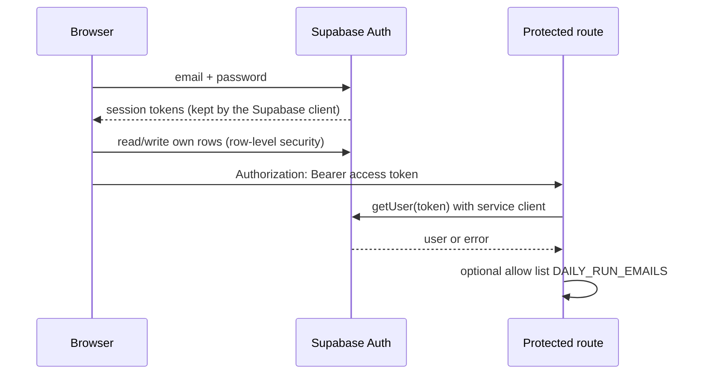

# Authentication and authorization

[Home](../README.md)

## Model
The app works without any account. Sign-in exists only with Supabase configured, for sync and to protect some
costly routes. There is no sign-up screen and no roles.

## Flow

Sessions and refresh are handled by `@supabase/supabase-js`
([cloud/client.ts](../../src/lib/cloud/client.ts), [use-cloud.ts](../../src/lib/cloud/use-cloud.ts)).

## Server authorization
[requireSignedIn](../../src/lib/cloud/auth.ts):

| Condition | Result |
| --- | --- |
| No database admin client (URL or **service role key** missing) | Allowed (rate limits only) |
| No or invalid token | 401 |
| `DAILY_RUN_EMAILS` set and email not on it | 403 |
| `DAILY_RUN_EMAILS` empty | Any account in your project is allowed |

Used by: `networking-draft`, `find-recruiter`, **[PR 7]** `job-check`.

**Not protected even with sign-in configured:** `search-jobs`, `analyze-resume`, `job-insights`,
`interview-prep`, **[PR 7]** `job-assessment`. Several of these spend Anthropic or job-board quota. See
[known risks](../07-security/known-risks.md).

## Morning run
`/api/cron/daily` compares a bearer secret in constant time and refuses secrets shorter than 16 characters
([daily-handler.ts](../../src/lib/cloud/daily-handler.ts)).

## Public keys
`NEXT_PUBLIC_SUPABASE_URL` and the anon key are public by design; protection is row-level security. Turn off
new sign-ups in Supabase, as the README describes.
