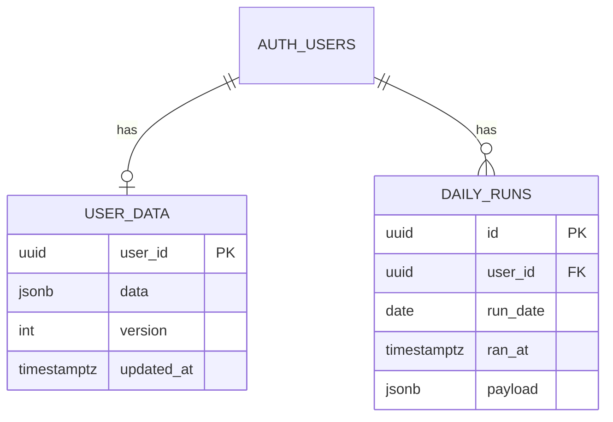

# Data models and database

[Home](../README.md)

## Types
Source of truth: [types/job.ts](../../src/types/job.ts), [contacts.ts](../../src/types/contacts.ts),
[watchlist.ts](../../src/types/watchlist.ts). Runtime checks: [schemas.ts](../../src/lib/schemas.ts),
[contacts/schema.ts](../../src/lib/contacts/schema.ts), [watchlist/schema.ts](../../src/lib/watchlist/schema.ts).

| Model | Key fields |
| --- | --- |
| `CandidateProfile` | summary, yearsOfExperience, seniority, skills (4 groups), roles, workHistory, education, certifications; **[PR 7]** certificationDetails, education.field |
| `SearchPreferences` | minSalary, locations, primary/secondary roles, weights, facts; **[PR 7]** transitionRoles, excludedRoles |
| `Job` | id, title, company, location, workMode, employmentType, category, salary, postedAt, description, descriptionTruncated, applyUrl, source, match, postingStatus, retrievedAt; **[PR 7]** enrichment, verification |
| `MatchResult` | score, deterministicScore, aiAdjustment, finalScore, eligibility, postingStatus, recommendedAction, ai, detail |
| `Application` | job, status, notes, dates, resume used, recruiter, offer, interviews, history |

**Compatibility rule:** Zod drops unknown keys. Every new stored field must be added to the schema as
optional, or it is lost on reload. Never narrow an existing field.

## Database (optional, Supabase)
Schema: [0001_init.sql](../../supabase/migrations/0001_init.sql). It is the only migration; run it by hand.

* `daily_runs` is unique per (user, date).
* Row-level security: a user reads and writes only their own `user_data`; they may read and delete their own
  `daily_runs`; only the service role writes runs.
* There are no tables for jobs, matches or applications: they live inside the `data` JSON.

No migration is needed for **[PR 7]**.
