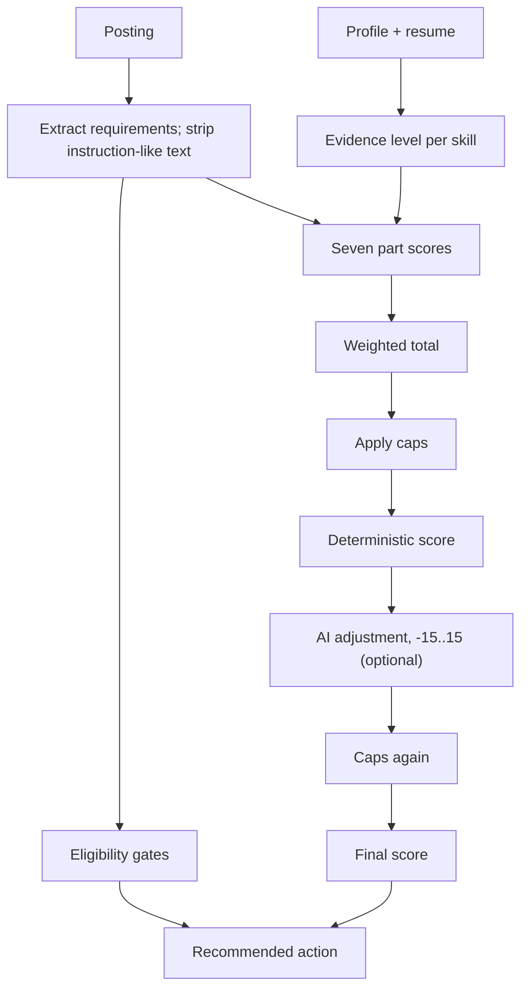

# Matching algorithm

[Home](../README.md)

Single scorer: `scoreJob` in [engine.ts](../../src/lib/matching/engine.ts). Everything here is deterministic
unless marked **AI**.

## Workflow

## Weights (default, configurable)

| Part (key) | Weight | Basis |
| --- | ---: | --- |
| Technical skills (`skills`) | 25 | Σ credit; preferred counts 0.4 |
| Relevant experience (`experience`) | 25 | With years asked: 0.45 × years fit + 0.55 × title fit; else title fit |
| Responsibilities | 20 | Kinds of work in the posting against work and project lines |
| Career alignment (`career`) | 10 | Stated target roles only |
| Seniority | 10 | Level difference: 0→100, +1→70, +2→35, +3→10, −1→88, lower→60 |
| Domain (`industry`) | 5 | Shared industry 100, else 40 |
| Location | 5 | yes 100, partial 55, no 10 |

A part with nothing to judge is skipped and the others share its weight.

## Skill credit

| Evidence on the resume | Credit |
| --- | ---: |
| Work under an employer | 100% |
| Project | 70% |
| Study or training | 40% |
| Only listed | 25% |
| Missing | 0% |

A related skill earns `relation credit × credit of the skill you have`
([transfer.ts](../../src/lib/matching/transfer.ts), relations in
[knowledge.ts](../../src/lib/matching/knowledge.ts)); it is reported as related, not matched. SQL is implied by
T-SQL, PL/SQL, SQL Server, PostgreSQL, MySQL and Azure SQL.

## Caps (lowest wins)

| Condition | Limit |
| --- | ---: |
| Evidence-weighted coverage of required skills under half (3+ required) | 65 |
| No required skill held (2+ required) | 55 |
| Outside your work and target roles | 60 |
| Skills match but responsibilities under 40 | 60 |
| Role 3+ levels above / 2 above / 2+ below | 55 / 70 / 65 |
| Outside your cities | 69 |
| Excluded word, or **[PR 7]** excluded role | 50 |
| Thin posting or fewer than 3 required skills | 89 |

## Eligibility
Citizenship or residency, work authorization, sponsorship, clearance, language
([detect.ts](../../src/lib/eligibility/detect.ts), [engine.ts](../../src/lib/eligibility/engine.ts));
**[PR 7]** degrees and certifications
([qualifications.ts](../../src/lib/eligibility/qualifications.ts) **[PR 7]**). `not_eligible` needs a stated requirement
**and** a contradicting statement from you; unknown is `needs_verification`.

## Confidence
Separate 0 to 100 (high ≥ 70, medium ≥ 45) from posting completeness, structure, resume completeness, evidence
and AI availability ([confidence.ts](../../src/lib/matching/confidence.ts)). Never part of the score.

## Recommended action
[recommend.ts](../../src/lib/matching/recommend.ts), in order: not eligible or closed → `not_recommended`;
needs verification → `verify_requirements` if score ≥ 45; low confidence → same; ≥ 75 `strong_match`;
≥ 60 `consider`; ≥ 45 `upskill` if required skills are missing, else `consider`; below → `not_recommended`.

## Changing it
Add a test first (`tests/matching.test.ts`, `tests/scenarios.test.ts`), then compare with
`tests/engine-comparison.test.ts` and, **[PR 7]**, `npm run benchmark`. Design history:
[matching-engine-v2.md](../matching-engine-v2.md).
