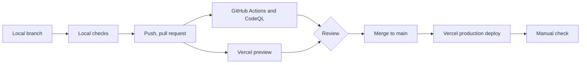

# Deployment, Vercel configuration and rollback

[Home](../README.md) · [CI/CD](ci-cd.md)

## Hosting
Vercel, connected to the GitHub repository. There is **no `vercel.json`**: Vercel's Next.js defaults apply, plus
`maxDuration` in each route and [next.config.ts](../../next.config.ts). Domain: `career-match-hub.vercel.app`.
Vercel project settings are not stored in the repository and were not inspected.

## From a change to production



**Merging to `main` is the production deployment.** Nothing blocks a merge when checks fail (no branch
protection).

## First-time deployment
Follow [README: Deploy to GitHub and Vercel](../../README.md#deploy-to-github-and-vercel). Add keys under
Project Settings → Environment Variables, then **redeploy**. `NEXT_PUBLIC_*` values are fixed at build time.

## Function time
Routes ask for 30 to 300 seconds (the morning run asks for 300). Check your plan's limit.

## Check after a deploy
```bash
curl https://career-match-hub.vercel.app/api/status
```
Expect JSON with `ai`, `jobProvider`, `recruiterWebSearch`. Then open the site and run one search.

## Rollback
1. In Vercel, **Deployments**, pick the last good production deployment and promote it (Vercel calls this
   rollback). This is the fastest route and was not exercised during this documentation work.
2. Then revert on GitHub so the next merge does not redeploy the fault:
```bash
git revert -m 1 <merge-commit-sha>
```
on a branch, followed by a pull request.

Browser data written by a newer version stays in users' browsers. New fields are optional; an older build drops
or rejects what it does not know, so take a backup before rolling back across data changes.
