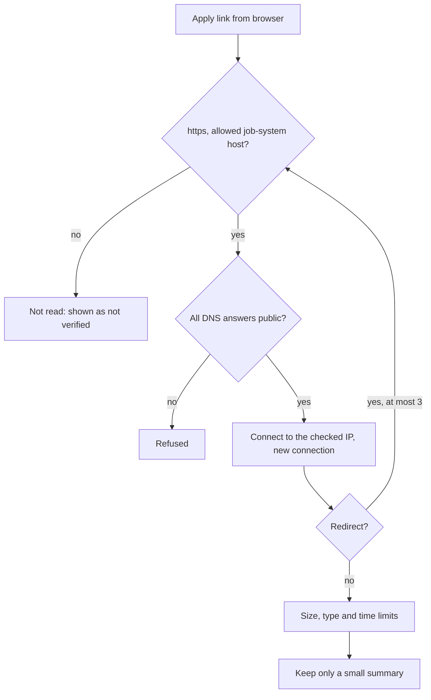

# SSRF protection: employer job-page verification [PR 7]

[Home](../README.md) · [Security overview](security-overview.md)

**Not in production** until PR 7 merges. The full audit record is
[security-page-reader.md](../security-page-reader.md).

## When it runs
A user presses **Check this posting** → `/api/job-check`. Pages are read only if `JOB_PAGE_FETCH` is exactly
`1`. **Default: off.** The JSearch detail lookup in the same route runs regardless of that setting.

## Who can call it
Anyone, subject to 15 requests per minute per client; where sign-in is enforced, only signed-in (and listed)
accounts.

## Controls

| Topic | Implementation | Source |
| --- | --- | --- |
| Allowed hosts | Workday, Greenhouse, Lever, SmartRecruiters, Ashby, iCIMS, Taleo, BambooHR, Jobvite, SuccessFactors, UKG, Dayforce, Paylocity, other applicant systems, Government of Canada and Ontario sites, Oracle recruiting hosts; whole host or true subdomain | [job-systems.ts](../../src/lib/jobs/job-systems.ts) |
| HTTPS | Required for the first request and each redirect; no credentials or port in the URL | same |
| IPv4 / IPv6 | Private, loopback, link-local, shared, multicast, reserved and special ranges refused; IPv6 only global unicast minus special blocks | [safe-fetch.ts](../../src/lib/net/safe-fetch.ts) |
| DNS rebinding | Name resolved once, every answer checked, connection pinned to a checked address, no connection pooling, certificate checks on | same |
| Redirects | Manual; revalidated; at most 3; off-list targets are reported, not followed | same |
| Timeouts, size | robots.txt 4 s and 200 KB; page 8 s and 1.5 MB; text content types; no decompression | same, [robots.ts](../../src/lib/net/robots.ts) |
| Forwarded data | None: only `Host`, `User-Agent`, `Accept`, `Accept-Encoding`, `Connection` | same |
| robots.txt | Honoured; unreadable means disallowed | robots.ts |
| Content handling | Linear-time parsing; page bodies not cached, only a bounded summary | [html.ts](../../src/lib/html.ts), [page-digest.ts](../../src/lib/jobs/page-digest.ts) |
| Failures | Fixed messages; blocked or failed is never "closed" | [verify.ts](../../src/lib/jobs/verify.ts) |
| Tests | [page-reader-security.test.ts](../../tests/page-reader-security.test.ts), [job-check.test.ts](../../tests/job-check.test.ts) (stand-in network and a local server) | |

## CodeQL alert: `js/request-forgery`

* State on 2026-11-26: **open** on the PR 7 branch (alert 15; earlier numbered 12, which closed when the
  code moved). **Not dismissed.** The CodeQL check therefore fails on the PR.
* Why: CodeQL traces the browser-supplied link to `https.request` and does not recognise the host list,
  address check or pinned lookup as barriers. The flow is real and intended.
* Assessment from the project audit: not an exploitable route to internal services or arbitrary domains in the
  tests performed; a **residual risk** remains.

## Residual risk
A permitted caller can make the server send GETs to any path on the listed job systems and obtain some page
text. IPv4 filtering is a block list. Trust rests on the vendors' DNS and certificates. Without sign-in only a
per-instance rate limit applies.

## Before enabling or dismissing
Dismissal, if the owner chooses it, should be "Won't fix" with the reasons above, not "False positive".
Enable `JOB_PAGE_FETCH` only if the site is protected or that residual use is acceptable. Do not weaken the
checks to silence the scanner.
